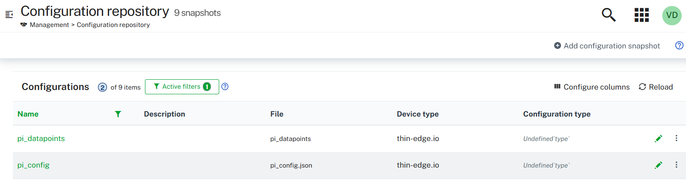

# PI Historian Service

A Python-based service for [thin-edge](https://thin-edge.io/) designed to read data from the AVEVA PI System using REST APIs and publish it to an MQTT broker via thin-edge. The application also supports live configuration updates, enabling runtime changes without the need for a restart.

## Architecture Diagram


## Features

- Periodic PI data collection via REST API (PI Web API)
- Structured MQTT message publishing to Cumulocity IoT via thin-edge
- Real-time monitoring of configuration file changes
- Dynamic reconfiguration without service restart
- Digital and enumeration tag support (handles JSON/dict values from PI digital points)
- Stable tag-to-batch assignment — each PI tag is permanently mapped to a batch ID regardless of adding or removing other tags
- Application logs written to `/etc/tedge/c8y/logs/` (persisted on host via volume mount, daily rotation)
- Batched publishing: tags are grouped into batches of `BATCH_SIZE`, each published as its own measurement type
- Payload splitting: batches larger than `MQTT_MAX_PAYLOAD_KB` are split into several MQTT messages so each stays under the Cumulocity 16 KB limit
- Configuration validation: invalid payload limits in `pi_config.json` are logged and replaced with safe defaults before they are applied, so a bad reload never stops publishing
- Automatic container restart (`restart: unless-stopped`) after a crash or a device reboot
- Offline (air-gapped) installation using a pre-built Docker image tarball

## Requirements

- Python 3.11+
- MQTT Broker (e.g., Mosquitto) version 2.1.0+
- Access to PI Web API

## Configuration

The following configuration files must be uploaded to the Cumulocity tenant for controlling the config changes remotely.

### Required Files

- `pi_config.json`: PI server connection details used to fetch data and authenticate against the PI system.

    ```json
    {
        "RECORDING_AT_TIME": "?time=",
        "POLL_INTERVAL": 60,
        "PI_USER": "default_user",
        "PI_PASSWORD": "default_password-base64-encoded",
        "PI_URL": "https://default-url.com/piwebapi",
        "BATCH_SIZE": 60,
        "MQTT_PUBLISH_TIMEOUT": 1,
        "MQTT_MAX_PAYLOAD_KB": 16,
        "MQTT_PAYLOAD_RESERVE_BYTES": 512
    }
    ```

    | Key | Default | Description |
    |---|---|---|
    | `RECORDING_AT_TIME` | `"?time="` | Query string prefix used when requesting a value at a specific timestamp from PI Web API. |
    | `POLL_INTERVAL` | `60` | Seconds between data collection cycles. |
    | `PI_USER` | — | PI Web API username. |
    | `PI_PASSWORD` | — | PI Web API password, base64-encoded. |
    | `PI_URL` | — | Full base URL of the PI Web API server. |
    | `BATCH_SIZE` | `60` | Maximum number of PI tags per MQTT measurement batch. Applies to every newly assigned tag; tags already in `tag_batches.json` keep their batch ID even if `BATCH_SIZE` changes. |
    | `MQTT_PUBLISH_TIMEOUT` | `1` | Seconds to wait for MQTT publish acknowledgement. A warning is logged if the message is not confirmed within this window. |
    | `MQTT_MAX_PAYLOAD_KB` | `16` | Maximum size of a single MQTT payload, a number between `1` and `16` (Cumulocity's limit). Any other value logs an error and falls back to `16`. A batch larger than this is split into several messages (see [Payload splitting](#payload-splitting)). |
    | `MQTT_PAYLOAD_RESERVE_BYTES` | `512` | Bytes kept free in every message for the wrapper thin-edge adds when forwarding to Cumulocity. Each message is at most `MQTT_MAX_PAYLOAD_KB × 1024 − MQTT_PAYLOAD_RESERVE_BYTES` bytes. Must be an integer between `0` and `4096`; any other value logs an error and falls back to `512`. Change it only if Cumulocity rejects messages close to the limit. |

    All keys except `PI_URL`, `PI_USER`, and `PI_PASSWORD` are optional. Values are validated each time the file is loaded, including live reloads. An invalid `MQTT_MAX_PAYLOAD_KB` or `MQTT_PAYLOAD_RESERVE_BYTES` is replaced with its default before the new configuration is applied, and an invalid `BATCH_SIZE` (not a positive integer) falls back to `60` when tags are assigned to batches.

- `datapoints.json`: List of PI tags to read and publish to Cumulocity, with optional friendly names.

    ```json
    [
        "78FIQ301.A",
        "78FIC102.A"
    ]
    ```

- `tag_batches.json` *(auto-generated)*: Persistent ledger that records the batch ID assigned to every PI tag. Created automatically on first run at `/etc/tedge/c8y/tag_batches.json`. Do not edit manually. If accidentally deleted it is regenerated with identical assignments as long as `datapoints.json` (including tag order) has not changed and no tags were previously removed.

    ```json
    {
        "_num_batches": 2,
        "78FIQ301.A": 0,
        "78FIC102.A": 1
    }
    ```

Upload the above configuration files into Cumulocity → Configuration Management tab, like below.



### Configuration via thin-edge

Update your `tedge-configuration-plugin` to include the configuration files uploaded to Cumulocity Configuration Management.

In the plugin configuration, the `type` values (for example, `pi_datapoints`) are the Cumulocity configuration type identifiers mapped to the local file paths; they are not the filenames themselves.

```toml
[[files]]
path = "/etc/tedge/tedge.toml"
type = "tedge.toml"

[[files]]
group = "tedge"
mode = 444
path = "/etc/tedge/plugins/tedge-log-plugin.toml"
type = "tedge-log-plugin"
user = "tedge"

[[files]]
path = "/etc/tedge/c8y/datapoints.json"
type = "pi_datapoints"
user = "tedge"
group = "tedge"
mode = 0o644

[[files]]
path = "/etc/tedge/c8y/pi_config.json"
type = "pi_config"
user = "tedge"
group = "tedge"
mode = 0o640
```

1. Push `tedge-configuration-plugin` configuration file first.
2. Then push:
   - `pi_config`
   - `pi_datapoints`

⚠️ The configuration plugin must be applied before deploying dependent configuration files.


## Prerequisites

Make sure the following are in place before proceeding:

- thin-edge installed and connected to the Cumulocity tenant — see [scripts/README.md](scripts/README.md) for the automated setup script
- Device registered as a thin-edge device
- Docker installed on the target VM
- Container group feature installed on the device
- Mosquitto broker exposed for external communication
- `unzip` package installed on the device

> **Automated setup:** `scripts/tedge_setup.sh` handles thin-edge installation, device registration (via OTP), certificate download, MQTT configuration, and PI connector prerequisites in a single command. Accepts Cumulocity domain with or without the `https://` prefix. See [scripts/README.md](scripts/README.md) for full instructions.

### thin-edge MQTT configuration

The PI connector runs inside a Docker container and connects to the Mosquitto broker on the host via `host.containers.internal`. By default Mosquitto only listens on `localhost`, which blocks this connection. Run the following **once** after thin-edge is installed and before starting the PI connector:

```bash
# Allow Mosquitto to accept connections from Docker containers
sudo tedge config set mqtt.bind.address 0.0.0.0

# Apply the change by reconnecting thin-edge to Cumulocity
sudo tedge reconnect c8y
```

> These steps are automated by `scripts/tedge_setup.sh install` — see [scripts/README.md](scripts/README.md).

---

## Build Instructions

### Option 1: Download Prebuilt Release (Recommended)

Download the latest stable build directly from GitHub Releases:

**Latest Release:**  
[repo release](https://github.com/Cumulocity-IoT/thin-edge-aveva-pi-connector/releases)

Two release assets are published for each version:

| Asset | Description |
|---|---|
| `pi_historian_connector_<version>_online.zip` | Standard release. Contains the source and `Dockerfile`; the image is built on the device on first run, so the device needs internet access to pull `python:3.11-slim` and the pip packages. |
| `pi_historian_connector_v<version>_offline.zip` | Offline release. Contains a pre-built Docker image tarball and pip wheels. No internet access required on the target device. See [Offline Installation](#offline-installation). |
| `pi-historian-flow_<version>.tar.gz` | thin-edge flow package for polling PI Web API from tedge-flows. See [pi-historian-flow](pi-historian-flow). |

---

### Option 2: Build From Source

#### Build both ZIPs using the build script

Running `build_release.sh` produces **both** the online and offline ZIPs in a single pass:

```bash
git clone https://github.com/Cumulocity-IoT/thin-edge-aveva-pi-connector.git
cd thin-edge-aveva-pi-connector

chmod +x scripts/build_release.sh
scripts/build_release.sh 1.1.3
```

The script will:
1. Create `pi_historian_connector_v1.1.3_online.zip` — source files only
2. Download pip dependency wheels for Python 3.11 / Linux x86_64
3. Build the Docker image locally
4. Export the image as a `.tar.gz` tarball
5. Generate an offline `docker-compose.yaml` with the correct image reference
6. Bundle everything into `pi_historian_connector_v1.1.3_offline.zip`
7. Clean up all temporary files and staging directories

The release CI (`release.yml`) runs the same script automatically on every tag push (`v*`) and can also be triggered manually via **Actions → Build and Upload ZIP Release → Run workflow**.

---

## Deploy Using Prebuilt Release (Standard / Online)

1. Download the `*_online.zip` from [releases](https://github.com/Cumulocity-IoT/thin-edge-aveva-pi-connector/releases)

2. Unzip the package:
   ```bash
   unzip pi_historian_connector_v<version>_online.zip -d pi_historian_connector_v<version>
   cd pi_historian_connector_v<version>
   ```

3. Start the service (Docker builds the image on first run and restarts the container automatically after a crash or reboot):
   ```bash
   docker compose up -d
   ```

---

## Offline Installation

Use this procedure when the target device has **no internet access**. Every file is prepared on a machine with internet access and then copied to the device.

### What you need

| Item | Where to get it | Used for |
|---|---|---|
| `pi_historian_connector_v<version>_offline.zip` | [Releases](https://github.com/Cumulocity-IoT/thin-edge-aveva-pi-connector/releases), or build it with `scripts/build_release.sh <version>` | The connector (pre-built Docker image, compose file, logging configuration) |
| `tedge-full_<version>_<arch>.deb`, `tedge-container-plugin-ng_<version>_<arch>.deb` | `apt-get download tedge-full tedge-container-plugin-ng` | thin-edge, only if it is not installed on the device yet |
| `scripts/tedge_setup.sh` | This repository | Automated thin-edge setup in offline mode |

> The offline image is built for **Linux x86_64** (`python:3.11-slim`, `manylinux2014_x86_64` wheels). It does not run on ARM devices such as a Raspberry Pi.

### Prerequisites on the target device

- Docker installed and running
- `docker compose` (v2) or `docker-compose` (v1) available
- `unzip` installed
- `sudo` access

### Step 1: Install thin-edge offline (skip if already installed)

On the machine with internet access, stage the thin-edge packages next to the setup script:

```bash
mkdir -p scripts/packages
apt-get download tedge-full tedge-container-plugin-ng
mv *.deb scripts/packages/
```

Copy `scripts/` to the device and run the setup script in offline mode:

```bash
scp -r scripts/ user@<device-ip>:/home/user/
ssh user@<device-ip>
chmod +x scripts/tedge_setup.sh
scripts/tedge_setup.sh install --offline
```

The script installs thin-edge from the local `.deb` files, connects the device to Cumulocity with a one-time password, sets `mqtt.bind.address` to `0.0.0.0`, and creates default `pi_config.json` and `datapoints.json` files in `/etc/tedge/c8y/`. The device still needs network access to your Cumulocity tenant. See [scripts/README.md](scripts/README.md#offline-installation) for details.

If thin-edge is already installed, make sure Mosquitto accepts connections from Docker containers (see [thin-edge MQTT configuration](#thin-edge-mqtt-configuration)).

### Step 2: Transfer the release bundle

Create a directory for the connector on the device and copy the offline ZIP into it using SCP, USB, or any other transfer method:

```bash
# On the device
sudo mkdir -p /pi_connector
sudo chown "$USER" /pi_connector

# On the machine with the ZIP
scp pi_historian_connector_v1.1.3_offline.zip user@<device-ip>:/pi_connector/
```

### Step 3: Unzip the bundle

```bash
cd /pi_connector
unzip pi_historian_connector_v1.1.3_offline.zip
```

The ZIP extracts its files directly into the current directory:

```
docker-compose.yaml                            # offline service definition (uses the pre-loaded image, restart: unless-stopped)
logging.conf                                   # logging configuration (writes to /etc/tedge/c8y/logs/)
requirements.txt                               # Python dependencies (reference only)
pi_historian_connector_1.1.3.tar.gz            # pre-built Docker image tarball
packages/                                      # pip wheels for offline pip install
  ├── requests-*.whl
  ├── urllib3-*.whl
  ├── paho_mqtt-*.whl
  ├── watchdog-*.whl
  └── ...
```

### Step 4: Load the Docker image

```bash
docker load < pi_historian_connector_1.1.3.tar.gz
```

Verify the image was loaded:

```bash
docker images | grep pi_historian_connector
```

Expected output:
```
pi_historian_connector   1.1.3   <id>   ...
```

The generated `docker-compose.yaml` references this exact tag (`image: pi_historian_connector:1.1.3`), so Docker never tries to pull or build it.

### Step 5: Check the configuration files

The service mounts `/etc/tedge/c8y` for configuration and log output. Make sure the following files exist on the device before starting:

```
/etc/tedge/c8y/pi_config.json
/etc/tedge/c8y/datapoints.json
```

`tedge_setup.sh` creates both files with default values. Update `PI_URL`, `PI_USER`, `PI_PASSWORD` (base64-encoded), and the tag list for your PI server, either locally or by pushing them from Cumulocity Configuration Management. See the [Configuration](#configuration) section for the expected formats. `tag_batches.json` is created by the service on first run.

### Step 6: Start the service

Start it with Docker Compose:

```bash
docker compose up -d
```

Or deploy it from Cumulocity: upload the offline ZIP to Software Management with the software type `container-group` and install it on the device, as described in [Production Deployment via Cumulocity](#production-deployment-via-cumulocity). Load the image (Step 4) first, because the device cannot pull it.

### Step 7: Verify it is running

```bash
docker compose ps
docker compose logs -f
tail -f /etc/tedge/c8y/logs/pi_historian.log
```

Application logs are written to `/etc/tedge/c8y/logs/pi_historian.log` on the host (rotated daily, 3 days retained). Each cycle logs the published batches, the number of parts per batch, and the payload size in KB. The container uses `restart: unless-stopped`, so Docker restarts it after a crash or a device reboot.

### Upgrading an offline installation

1. Copy the new `*_offline.zip` to the device and unzip it into a new directory, for example `/pi_connector/1.1.4`.
2. Load the new image: `docker load < pi_historian_connector_1.1.4.tar.gz`
3. Stop the old version from its directory: `docker compose down`
4. Start the new version from the new directory: `docker compose up -d`
5. Optionally remove the old image: `docker rmi pi_historian_connector:1.1.3`

Configuration files, `tag_batches.json`, and its backups live in `/etc/tedge/c8y` on the host, so batch IDs are kept across upgrades.

### Stopping the service

```bash
docker compose down
```

---

## Production Deployment via Cumulocity

### 1. Upload the Zipped Archive

- Go to the **Cumulocity Software Management UI**
- Upload the `.zip` file
- Set the **Software Type** to `container-group`

### 2. Deploy to thin-edge Device

- Navigate to the target **thin-edge device** in Cumulocity Device Management
- Go to **Software > Install**
- Select the uploaded software package and version

The container will be deployed and started automatically on the thin-edge VM.


## Batch Assignment

PI tags are grouped into batches before being published to MQTT. Each batch is published as a separate measurement type (`pi_historianMeasurement_batch<N>`) and metadata topic (`pi_historianMetadata_batch<N>`).

### How batch IDs are assigned

The ledger `/etc/tedge/c8y/tag_batches.json` is the single source of truth. A tag's batch ID is assigned once and never recomputed:

1. A tag already in the ledger always keeps its batch ID.
2. A new tag is placed in the lowest-numbered batch holding fewer than `BATCH_SIZE` tags (in `datapoints.json` order).
3. If every batch is full, a new batch (`highest ID + 1`) is opened.
4. A removed tag keeps its ledger entry and still counts toward its batch, so re-adding it can never push a batch over the limit.

This guarantees no batch assigned by the service exceeds `BATCH_SIZE`, which bounds the MQTT payload size. `_num_batches` in the ledger is informational only (number of batch IDs in use).

Ledgers created by older versions (hash-based assignment) are kept as-is: existing tags keep their IDs, and any batch already above `BATCH_SIZE` stays that size (a warning is logged) but receives no new tags.

### Stability guarantees

| Scenario | Result |
|---|---|
| Tag added to `datapoints.json` | Assigned to the first batch with room, or a new batch; all existing tags keep their batch ID |
| Tag removed from `datapoints.json` | Ledger entry is retained; re-adding the tag later restores the same batch ID |
| `BATCH_SIZE` changed | Existing tags stay put; only newly added tags follow the new limit |
| `tag_batches.json` deleted accidentally | Regenerated on next startup; assignments are **identical** if `datapoints.json` (and its order) has not changed and no tags had been removed. Otherwise restore from a backup (below) |

### Payload splitting

If a batch serializes to more than `MQTT_MAX_PAYLOAD_KB` (default 16 KB) minus a 512-byte reserve, it is split into several messages. The reserve leaves room for the wrapper thin-edge adds when forwarding twin messages to Cumulocity, so each part stays under the limit end to end. Series are never split across messages.

- **Measurements:** every part is published to `c8y/measurement/measurements/create` with the same `type` (`pi_historianMeasurement_batch<N>`), `time` and fragment name. Each part becomes a separate measurement, and the series stay continuous in Cumulocity.
- **Metadata:** a twin publish replaces the whole fragment, so each part gets its own fragment: `pi_historianMetadata_batch<N>` for the first part, then `pi_historianMetadata_batch<N>_part2`, `_part3`, ... If a batch later shrinks back to fewer parts, the extra `_partK` fragments are not removed automatically. A description too large to fit in a message on its own is truncated to fit, ending with `...`.

The number of parts per batch is logged with each publish. Metadata is published per batch independently: if one batch fails (for example a PI error), the remaining batches are still published.

### Automatic backups

Every time `tag_batches.json` is updated, the previous version is backed up automatically before the new content is written:

- **Backup location:** `/etc/tedge/c8y/tag_batches_backups/`
- **Naming format:** `tag_batches_YYYYMMDD_HHMMSS.json` (UTC timestamp)
- **Retention:** last 10 backups are kept; older ones are deleted automatically

```
/etc/tedge/c8y/tag_batches_backups/
  tag_batches_20260828_083000.json
  tag_batches_20260828_091500.json
  tag_batches_20260828_102300.json
  ...  (max 10 files)
```

To restore a backup, copy the desired file back to `/etc/tedge/c8y/tag_batches.json` and restart the service.

### Supported operations

The following operations are safe and fully supported at any point in the service lifecycle.

| Operation | How | What happens |
|---|---|---|
| **Add new PI tags** | Append entries to `datapoints.json` | Each new tag is assigned to the first batch with room (or a new batch) on the next file-change event. All existing tag-to-batch assignments stay unchanged. |
| **Remove PI tags** | Delete entries from `datapoints.json` | The tag stops being polled and published. Its ledger entry is kept in `tag_batches.json`, so re-adding the same tag name later restores the exact same batch ID. |
| **Rebalance / resize batches** | Delete `tag_batches.json` while the full desired tag list is already in `datapoints.json`, then restart | Tags are packed into batches of `BATCH_SIZE` in `datapoints.json` order. Do this only intentionally — all tags move to new batch IDs and existing Cumulocity measurement topics become orphans. |
| **Restore a previous batch layout** | Copy the desired file from `/etc/tedge/c8y/tag_batches_backups/` back to `/etc/tedge/c8y/tag_batches.json`, then restart | The service picks up the restored ledger and resumes publishing under the batch IDs it contained. |
| **Change poll interval** | Update `POLL_INTERVAL` in `pi_config.json` and push via Cumulocity | Takes effect on the next configuration reload without a restart. |
| **Scale the tag list** | Keep adding tags to `datapoints.json` | New batches are opened automatically as existing ones fill up; no batch exceeds `BATCH_SIZE`. |
| **Inspect current batch layout** | Read `/etc/tedge/c8y/tag_batches.json` | Shows the batch ID for every known tag and the number of batch IDs in use (`_num_batches`). |

### Limitations and what not to do

| # | What not to do | Why |
|---|---|---|
| 1 | **Do not expect `BATCH_SIZE` changes to resize existing batches** | Existing tags never move. Lowering `BATCH_SIZE` only limits batches filled after the change; to shrink existing batches you must delete `tag_batches.json`, which remaps tags and orphans existing Cumulocity topics. |
| 2 | **Do not manually edit tag entries in `tag_batches.json`** | Incorrect or duplicate entries will cause tags to be published under the wrong batch topic or skipped entirely. Use backups to restore if the file is corrupted. |
| 3 | **Do not rename a PI tag without updating the ledger** | A renamed tag is treated as a completely new tag and assigned to the first batch with room. The old entry remains in the ledger (still occupying a slot) and the old Cumulocity series will stop receiving data. |
| 4 | **Do not delete `tag_batches.json` after removing or reordering tags** | Regeneration packs the current `datapoints.json` in order, so removed or reordered tags shift other tags to different batch IDs. Restore from a backup instead. |
| 5 | **Do not rely on very long PI descriptions being published in full** | Splitting works per series. If one tag's description alone does not fit in a message, it is truncated to fit and ends with `...` (a warning is logged). Measurement values are never truncated; a single measurement series over the limit (not expected for `Float32` points) is published as-is with an error logged. |
| 6 | **Do not push `tag_batches.json` via Cumulocity Configuration Management** | The file is managed entirely by the application. Pushing it from Cumulocity would trigger the file watcher and reload datapoints, but the file would be overwritten again on the next tag list change. |

---

## MIT License

This project is licensed under the MIT License. See the [LICENSE](LICENSE) file for full details.

## Disclaimer
AVEVA, PI System, and PI Server are trademarks or registered trademarks of AVEVA Group plc or its subsidiaries in the U.S. and other countries. This project is an independent open-source initiative and is not affiliated with, sponsored by, or endorsed by AVEVA.

-------------------------------------------
These tools are provided as-is and without warranty or support. They do not constitute part of the Cumulocity product suite. Users are free to use, fork and modify them, subject to the license agreement. While Cumulocity GmbH welcomes contributions, we cannot guarantee to include every contribution in the master project.

----------------------------------
You can find additional information in the [Cumulocity Community](https://community.cumulocity.com/).
